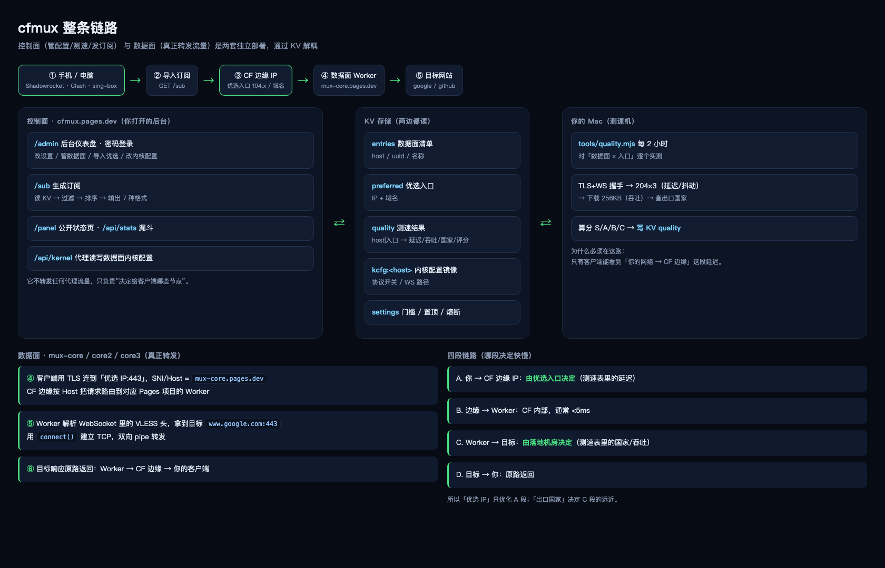

# cfmux

基于 Cloudflare 的代理**控制面**：自动收录优选 IP/域名 → 实测质量 → 生成带国家名的订阅。
数据面直接使用成熟内核（cfnew），本项目不魔改内核，只做「质量 + 自动化 + 后台」。

```
订阅规模：候选 433 → 通过质量门槛 174 → 去重 35 → 输出 96~175 个节点
国家识别：美国 · 日本 · 新加坡 · 荷兰 · 瑞典 · 德国 · 西班牙 · 英国 · 法国（识别率 ≈ 98%）
```

---

## 一、原理



### 1.1 两套独立部署

| 部署 | 例子 | 职责 | 转发流量 |
| --- | --- | --- | --- |
| **控制面** | `cfmux.pages.dev` / `mux.moneyfly.club` | 后台、订阅生成、统计、内核配置代理 | ❌ |
| **数据面** | `mux-core.pages.dev` / `core1.moneyfly.club` … | 解析 VLESS/Trojan + `connect()` 转发 | ✅ |
| **KV** | 控制面项目的 KV | entries / preferred / quality / kcfg / settings | — |
| **测速机** | 你的 Mac（可选） | 实测质量并上报 | ❌ |

控制面只决定「给客户端哪些节点」，数据面才真正搬运流量。两者通过 KV 解耦。

### 1.2 一次上网请求的完整路径

```
① 客户端选节点：vless://<uuid>@104.17.2.1:443?host=core1.moneyfly.club&path=/?ed=2048
② 客户端 TLS 连 104.17.2.1:443，SNI = core1.moneyfly.club
③ Cloudflare 边缘按 Host 路由到该 Pages 项目的 Worker
④ Worker 从 WebSocket 帧里解出 VLESS 头 → 目标 www.google.com:443
⑤ Worker 用 connect() 建 TCP，双向 pipe 转发
⑥ 响应原路返回：目标 → Worker → 边缘 → 客户端
```

> `server`（104.17.2.1）是**入口 IP**，不是出口；`host/SNI` 决定落到哪个数据面；
> 真正出口在哪，由数据面所在机房决定（这就是测速表里的“国家”）。

### 1.3 四段链路，谁决定快慢

| 段 | 路径 | 由什么决定 |
| --- | --- | --- |
| A | 你 → 边缘 IP | **优选入口**（测速表的延迟） |
| B | 边缘 → Worker | CF 内部，通常 <5ms |
| C | Worker → 目标 | **落地机房**（测速表的国家/吞吐） |
| D | 目标 → 你 | 原路返回 |

换优选 IP 只优化 A 段，选国家优化 C 段，两者不能互相替代。

---

## 二、节点是怎么生成的

### 2.1 四类输入

| 符号 | 名称 | 来源 | 内容 |
| --- | --- | --- | --- |
| `E` | entries 数据面 | KV `entries` | `{name, host, uuid, path}` |
| `C` | candidates 候选入口 | KV `preferred` + 外部优选源 | IP / 域名 |
| `Q` | quality 质量表 | KV `quality` | `"host\|入口" → {ok,score,tput,lat,jitter,cc,ts,cooldownUntil}` |
| `K` | kernel 内核配置 | KV `kcfg:<host>`（保存时镜像） | `{ev,et,ex,ech,d,p,tp,…}` |

### 2.2 四步生成

```
① 内核闸门：决定「这个入口能不能出节点、什么协议、什么路径」
   ev≠yes 且 (et≠yes 或 tp 为空) → 跳过该入口
   proto = ev=yes ? vless : trojan
   path  = K.d || '/'

② 质量闸门：决定「这个组合要不要」
   必须有 Q[host|入口]；ok=true；未熔断；score≥minScore；tput≥minTput
   数据新鲜度：≤maxAgeHours 正常 → ≤softExpireDays 保留但降 15 分排后 → 超过则丢弃

③ 后处理：去重(同出口 IP 留最高分) → 每入口取 topK(perEntry) → 排序(pinned 优先) → limit 截断

④ 格式化：base64 / clash / singbox / plain / json / qx / loon
```

### 2.3 为什么“达标数”和“订阅节点数”不一样

```
候选 433（3 数据面 × 145 入口）
 → 通过质量门槛 174
 → 去重 -35（同一出口 IP 只留评分最高）
 → 输出 96~139
```

仪表盘「概览」直接显示这条漏斗，也可 `GET /api/stats` 查看。

### 2.4 测速在哪跑

**不在 Worker 里**。Worker 看不到「你的网络 → CF 边缘」这段延迟，只有客户端侧才准确。

```
TLS+WS 握手 → VLESS 请求 204 ×3（延迟/抖动）→ 隧道下载 256KB（吞吐）
→ 经隧道查出口国家（ip-api → ipinfo → IP-only 源）→ 评分 S/A/B/C → 写 KV
```

两个执行入口（任选或都用）：

| 入口 | 频率 | 特点 |
| --- | --- | --- |
| 本机 launchd | 2 小时 | 最准（你真实网络视角） |
| GitHub Actions | 3 小时 | 云端保活，**你电脑关机也能跑** |

质量数据带时间戳：48 小时内正常、30 天内降权保留、超 30 天丢弃；另有“上次成功订阅”兜底（24 小时）。

---

## 三、部署

### 3.1 数据面（完整内核，不修改）

```bash
# 1) 取内核
curl -sL https://github.com/byJoey/cfnew/releases/latest/download/_worker.js -o kernel.js

# 2) 建 Pages 项目（每个数据面一个）
wrangler pages project create mux-core --production-branch main
#    控制台 → 项目 → 设置 → 变量：u = <UUID>；KV 绑定 C = <命名空间>

# 3) 部署
mkdir -p core && cp kernel.js core/_worker.js
wrangler pages deploy core --project-name mux-core

# 4) 验证：/ 返回 hello；/<uuid>/api/config 返回 JSON
```

需要 1~3 个数据面（分摊 10 万请求/天/项目，并做故障隔离）。

### 3.2 控制面

```bash
git clone <本仓库> && cd cfmux

# 1) 建项目
wrangler pages project create cfmux --production-branch main

# 2) 设变量（控制台或 API）
#    uuid          数据面 UUID（单数据面时用）
#    admin_password 后台密码
#    report_token  上报口令（CI/本机写质量用，随便生成一串随机值）
#    KV 绑定 KV = <命名空间>

# 3) 部署（内置双重语法校验）
./tools/deploy.sh
```

### 3.3 初始化数据

```bash
B=https://cfmux.pages.dev
# 登录拿 Cookie
curl -c /tmp/ck.txt -X POST "$B/admin/login" -d "password=<admin_password>" -o /dev/null
# 写入数据面
curl -b /tmp/ck.txt -X POST "$B/admin/save" -H "Content-Type: application/json" \
  -d '{"entries":"[{\"name\":\"core1\",\"host\":\"mux-core.pages.dev\",\"uuid\":\"<UUID>\",\"path\":\"/\"}]"}'
# 导入优选域名
curl -b /tmp/ck.txt -X POST "$B/api/import" -H "Content-Type: application/json" \
  -d '{"url":"https://bestcf.fxxk.dedyn.io/cf_domains.txt"}'
```

### 3.4 测速（二选一）

**A. 本机（推荐，最准）**
```bash
cp .refresh.env.example .refresh.env   # 填 KV_ID / ENTRIES_FILE / PREF_FILE
echo "<report_token>" > .report_token
./tools/refresh.sh                     # 测完自动上报
# 定时（macOS launchd，每 2 小时）
```

**B. GitHub Actions（云端保活）**
```
仓库 Settings → Secrets: CFMUX_REPORT_TOKEN = <report_token>
            → Variables: CFMUX_BASE = https://cfmux.pages.dev
工作流 .github/workflows/refresh-quality.yml 已配置每 3 小时运行
```
只用一个自定义上报口令，**不需要把 Cloudflare Token 放进 GitHub**。

### 3.5 可选：自定义域名

| 记录 | 值 |
| --- | --- |
| CNAME `mux` → `cfmux.pages.dev` | 控制面域名（可达 `mux.<你的域名>/admin`） |
| CNAME `core1/2/3` → `mux-core*.pages.dev` | 数据面域名（防 `pages.dev` 被污染） |

加完后在 Pages 项目 → 自定义域 添加，然后后台「数据面」把 host 换成新域名。

---

## 四、订阅

```
https://<域名>/sub                     # Base64（V2Ray / Shadowrocket / v2rayN）
https://<域名>/sub?target=clash        # Clash / Meta / Stash / Mihomo
https://<域名>/sub?target=singbox      # sing-box
https://<域名>/sub?target=plain        # 纯 URI 列表
https://<域名>/sub?target=json         # JSON 节点数组
https://<域名>/sub?target=qx           # Quantumult X
https://<域名>/sub?target=loon         # Loon
```

| 参数 | 说明 |
| --- | --- |
| `limit` | 节点数，0=全部（≤300） |
| `kind` | `ip` / `domain` |
| `cc` | 国家代码，如 `cc=SG,JP` |
| `country` | 国家名，如 `country=新加坡` |
| `like` | 候选值关键字 |
| `perEntry` | 每入口取几个，0=不限 |
| `dedup` | `0` 关闭去重 |
| `unmeasured` | `1` 放行未测速的数据面 |
| `nocache` | `1` 跳过 60 秒缓存 |
| `refreshKernel` | `1` 强制重读数据面内核配置 |

短链：后台「订阅」页生成 `/s/<token>`，删除即失效。

---

## 五、后台（`/admin`）

| 标签 | 能做什么 |
| --- | --- |
| 概览 | 指标卡、国家分布、节点生成漏斗、评分趋势、Top 节点 |
| 节点质量 | 全量节点表（筛选/排序）、置顶、熔断/解除 |
| 订阅 | 7 种订阅地址、二维码（本地生成）、短链管理 |
| 优选 | 手动编辑、从网址导入、手动触发测速 |
| 内核 | 读取/修改数据面内核（协议开关、路径、ProxyIP、ECH…） |
| 流量 | 请求量统计（近似）、7 天柱状图 |
| 数据面 | 增删改（host/uuid/路径），显示测速覆盖情况 |
| 设置 | 质量门槛、淘汰参数、通知（Telegram/Webhook）、区域映射 |

公开页：`/panel`（状态）、`/api/stats`（漏斗）、`/api/quality`（质量排行）。

---

## 六、配置速查

**环境变量（控制面）**

| 变量 | 必填 | 说明 |
| --- | --- | --- |
| `uuid` | ✅ | 数据面 UUID（单数据面时兜底） |
| `admin_password` | ✅ | 后台密码；不设则后台关闭 |
| `report_token` | 推荐 | 上报口令（CI/本机写质量） |
| `gh_token` / `gh_repo` | 可选 | 「手动触发测速」按钮（Actions workflow_dispatch） |
| `KV` 绑定 | ✅ | 存储 entries/preferred/quality/… |

**设置项（后台可改，存 KV `settings`）**

| 键 | 默认 | 作用 |
| --- | --- | --- |
| `minScore` / `minTput` | 0 / 0 | 评分、吞吐下限 |
| `maxAgeHours` / `softExpireDays` | 168 / 30 | 数据新鲜 / 硬过期（天） |
| `limit` / `perEntry` | 0 / 0 | 输出上限 / 每入口取几个 |
| `pruneStrikes` / `pruneFloor` / `banHours` | 4 / 120 / 72 | 自动淘汰规则 |
| `autoPromote` / `promoteMinScore` | true / 55 | 高分自动进入优选池 |
| `tg_token` / `tg_chat` / `webhook_url` | — | 告警通知 |

---

## 七、常见问题

**订阅提示「没有达标节点」？**
① 看 `/api/stats` 的 candidates 是否为 0（数据面没配好或 KV 读抖动）；
② 看 quality 是否有数据（没跑过测速）；
③ 门槛是否过严（`minScore` 太高）。
系统已有「上次成功结果」兜底（24h），一般不会空着。

**节点数比“达标节点”少？**
同出口 IP 去重是主因，其次 `perEntry`/`limit`/国家筛选。

**节点名显示「IP / 域名」而不是国家？**
该组合没取到出口 IP。重跑测速即可补齐（批量地理二次解析）。

**电脑关机还会掉订阅吗？**
不会。订阅由 Cloudflare 生成；只是质量数据不再更新，超过 30 天才逐步丢弃。
云端 Actions（3 小时）可以完全替代本机。

**改了内核路径，订阅会跟着变吗？**
会。订阅生成时会读内核配置（KV 镜像 `kcfg:<host>`），协议开关与 WS 路径都会同步。

---

## 八、目录

```
src/index.js             控制面（路由/订阅/后台/API/内核代理/通知）
tools/quality.mjs        测速引擎（延迟/抖动/吞吐/国家/评分/看门狗）
tools/refresh.sh         本机定时刷新（测速 + 上报 + 历史曲线）
tools/deploy.sh          安全部署（Worker 语法 + 渲染后浏览器 JS 双校验）
tools/check-dash.js      渲染 /admin 并校验内联脚本
tools/measure.mjs        简易测速（早期版本，保留）
tools/colos.mjs          数据中心探测
.github/workflows/       云端定时测速
docs/architecture.png    架构图
docs/HISTORY.md          详细开发记录（v1.x ~ v3.x）
```

## 九、安全说明

- 后台 Cookie = `SHA-256("cfmux|密码")`，HttpOnly + Secure + SameSite=Lax，7 天
- 登录失败 5 次锁定 10 分钟（按 IP）
- 上报接口用独立 `report_token`，与后台密码分离
- 导入接口只允许 http/https 公网地址（拒绝内网/元数据地址）
- 敏感配置（Telegram Token 等）存 KV，只能通过你的账号读取
- 建议：自定义域名 + 强密码 + 定期轮换 `report_token`
